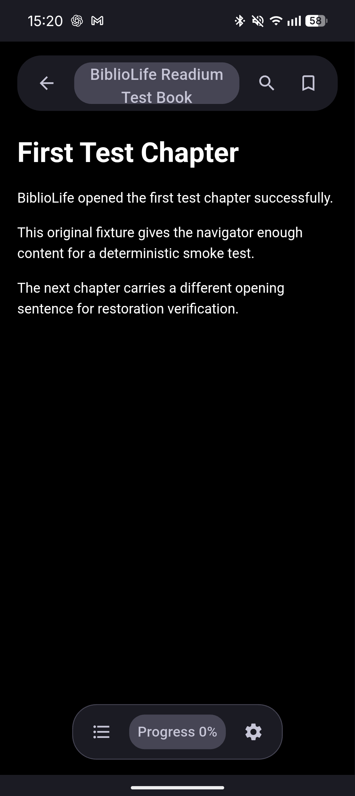
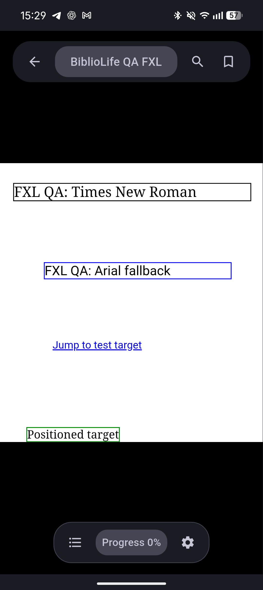

# BiblioLife

BiblioLife is an open-source Android book library and reader built with Flutter and Readium.

## Screenshots

 

## Build Android v1.0.0

Use Flutter 3.44.7 (Dart 3.12.2), Android SDK 36, NDK 28.2.13676358, and JDK 21. The source pins Gradle 9.1.0, Android Gradle Plugin 9.0.1 and Kotlin 2.3.20.

```sh
flutter pub get --enforce-lockfile
flutter build apk --debug -t lib/main.dart
```

Install the development build on Android 7.0 (API 24) or newer with `adb install -r build/app/outputs/flutter-apk/app-debug.apk`. For production builds, see [signing](docs/development/build-and-release.md#signing-and-versioning). Android checks the package and signing certificate when updating an existing installation.

## Implemented functionality

- Local book import and library presentation, including grid/list views and collections.
- Book Details with metadata editing, cover selection, reading progress, contents, bookmarks and annotations.
- EPUB reading through the local Readium bridge, with reader settings and progress navigation. Annotation overlap merging has known limitations.
- Online catalog browsing/search and a persisted sequential EPUB download/import queue; Google Books search configuration is available separately.
- Material 3 light/dark themes with platform dynamic-color fallback.

Evidence: `lib/features/import/data/services/book_importer.dart`, `lib/app/router/app_router.dart`, `lib/features/book_details/`, `lib/features/reader/`, and the linked Online baseline. Reader navigation and reflow remain under development; source implementation does not establish physical-device acceptance. Platform scaffold directories do not establish feature parity with Android.

## Tech stack

Flutter / Dart (Dart SDK constraint `^3.12.2`), Riverpod, GoRouter, Drift, dynamic_color, file_picker, archive/XML tooling, pdfx, and the local `bibliolife_readium` package. Android includes the customized Readium Kotlin toolkit checkout. Dependency constraints and resolved versions are recorded in `pubspec.yaml` and `pubspec.lock`.

## Main directories

| Directory | Purpose |
| --- | --- |
| `lib/app/` | Application startup, routing, themes and localization |
| `lib/features/` | Feature presentation, application, domain and data layers |
| `lib/shared/`, `lib/core/` | Shared components and infrastructure |
| `packages/bibliolife_readium/` | Flutter/Android reader bridge |
| `third_party/readium-kotlin-toolkit/` | Customized native toolkit; preserve local changes |
| `assets/` | Reader resources and application artwork |
| `test/`, `integration_test/` | Automated checks and integration scenarios |
| `docs/` | Technical references |

## Development setup

1. Install Flutter with a Dart SDK satisfying `pubspec.yaml`, and an Android SDK/toolchain compatible with the checked-in Gradle configuration.
2. Preserve the customized Readium checkout and bridge; replacing them with a stock upstream checkout changes the application.
3. Configure local Flutter/Android SDK paths in `android/local.properties` as required by `android/settings.gradle.kts`.
4. From the project root, use the normal application entrypoint:

```sh
flutter pub get --enforce-lockfile
flutter run --debug -t lib/main.dart -d <device-id>
```

Android Gradle configuration can generate the nested toolkit's local SDK properties. Do not use the Library benchmark harness as a normal entrypoint. Keep API keys outside source control; see the Google Books guide.

## Artwork and asset provenance

See [ASSETS.md](ASSETS.md) for the owner-confirmed application artwork and platform icon generation, and [release asset provenance](docs/release/asset-provenance.md) for the third-party resource audit.

## Documentation

- [Documentation index](docs/index.md)
- [Current product roadmap](docs/product/roadmap.md)
- [Application architecture](docs/architecture/overview.md)
- [Development setup](docs/development/setup.md)
- [Android build and release — signing setup and remaining blockers](docs/development/build-and-release.md)
- [Implemented design system](docs/design/design-system.md)
- [Implemented motion](docs/design/motion.md)
- [Online technical baseline](docs/architecture/online_technical_baseline.md)
- [Google Books configuration](docs/development/google_books_configuration.md)
- [Release asset provenance](docs/release/asset-provenance.md)
- [Font provenance and redistribution terms](docs/release/font-provenance.md)
- [Android Fixed-Layout font limitation](docs/release/android-fxl-font-patch.md)
- [Nothing A065 release acceptance checklist](docs/release/android-device-acceptance-checklist.md)

## Build and tests

The previous development validation used Flutter 3.44.7 / Dart 3.12.2 and Gradle 9.1.0. These are observed toolchain versions, not a fully pinned build environment. Install a compatible Android SDK/JDK and configure paths locally; keep android/local.properties out of version control. The current Drift schema is 23.

```sh
flutter pub get --enforce-lockfile
flutter analyze --no-pub
flutter test --no-pub
flutter build apk --debug -t lib/main.dart
```

BiblioLife v1.0.0 for Android reads EPUB (including fixed-layout EPUB), PDF, FB2, TXT and CBZ. CBR/RAR extraction is unavailable in this release. Existing CBR entries and original files remain in the library and can be exported. Google Books discovery requires a locally supplied API key. Release builds are unsigned unless a private production key is configured in `android/key.properties`.

For the navigator JavaScript tests, install Node.js and enable Corepack, then from `third_party/readium-kotlin-toolkit/readium/navigator/src/main/assets/_scripts` run:

```sh
corepack pnpm install --frozen-lockfile
node --test test/decoration-text-geometry-contract.test.js test/initial-restore-range.test.js test/locator-point-diagnostic-contract.test.js test/selection-custom-handles-contract.test.js
corepack pnpm exec playwright install chromium
node --test test/continuous-dom-anchor.browser.test.js
```

The browser test needs a Playwright Chromium download or a compatible browser specified by `ANCHOR_TEST_BROWSER`. Do not set `NODE_PATH` to another project's dependencies. Native checks can be run with the appropriate Android SDK and JDK, using `gradlew.bat` on Windows or `./gradlew` on Unix:

```sh
# From android/
./gradlew :bibliolife_readium:testDebugUnitTest
# From third_party/readium-kotlin-toolkit/
./gradlew :readium:readium-navigator:testDebugUnitTest
```

See [build and release](docs/development/build-and-release.md) for signing limitations.

## Android Fixed-Layout font limitation

The optional legacy Readium Android system-font patch (Nimbus Sans/Roman WOFF) is not included. The BiblioLife Android navigator does not load this patch, and the build configuration explicitly excludes it from regenerated Readium CSS assets. Fixed-Layout EPUBs that depend on unembedded Times/Times New Roman/Arial/Helvetica metrics may therefore use Android system fallback fonts and can have different line geometry or text overflow compared with a reading system that injects the patch. See [the FXL font patch note](docs/release/android-fxl-font-patch.md).

## License and third-party material

BiblioLife's original code and project-owned contributions are licensed under **GNU General Public License v3.0 or (at your option) any later version (GPL-3.0-or-later)**. The complete license text is in [`LICENSE`](LICENSE). The scope and exclusions are described in [`LICENSE_SCOPE.md`](LICENSE_SCOPE.md).

This license grant applies only to material for which the BiblioLife contributors have the rights to grant it. It does not relicense third-party or vendored components, fonts, icons, templates, test fixtures, or other assets that carry separate terms. Those materials retain their own licenses and notices; see [`THIRD_PARTY_NOTICES.md`](THIRD_PARTY_NOTICES.md).
