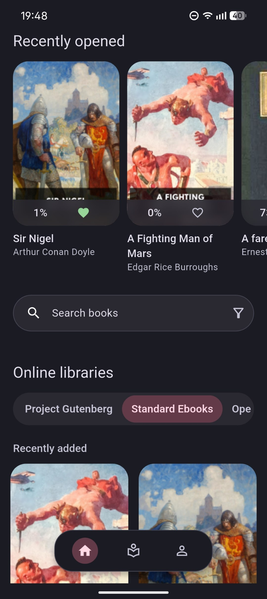
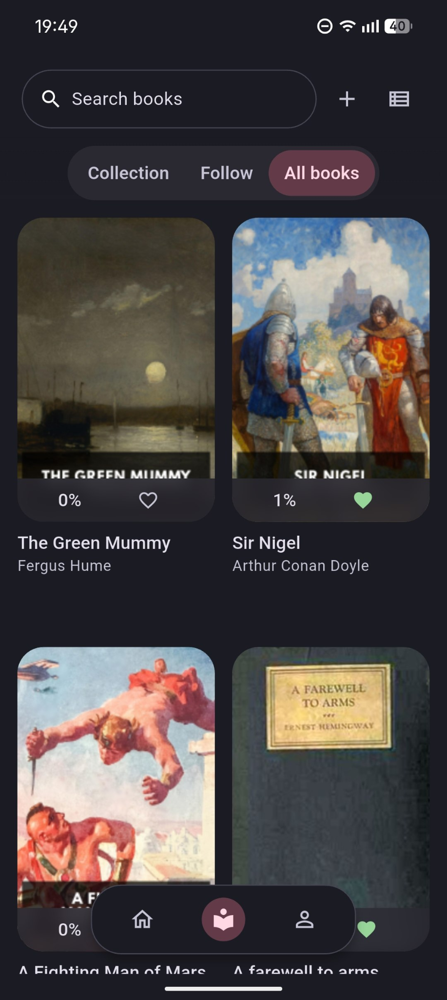
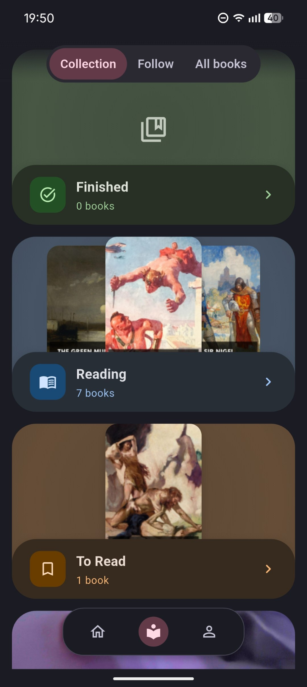
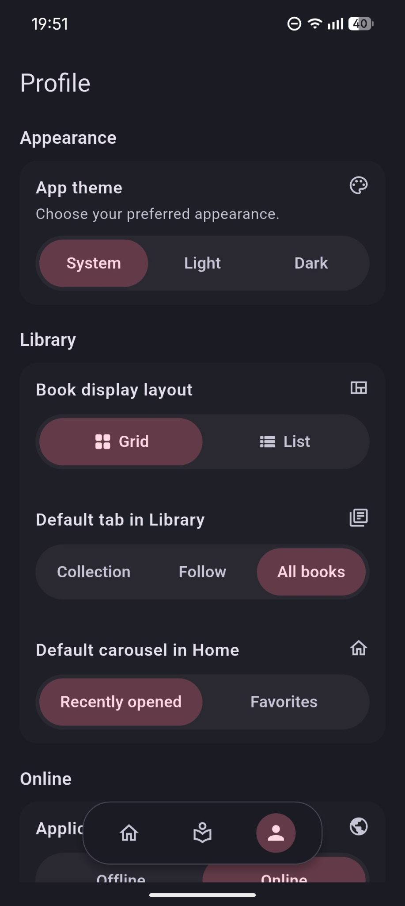
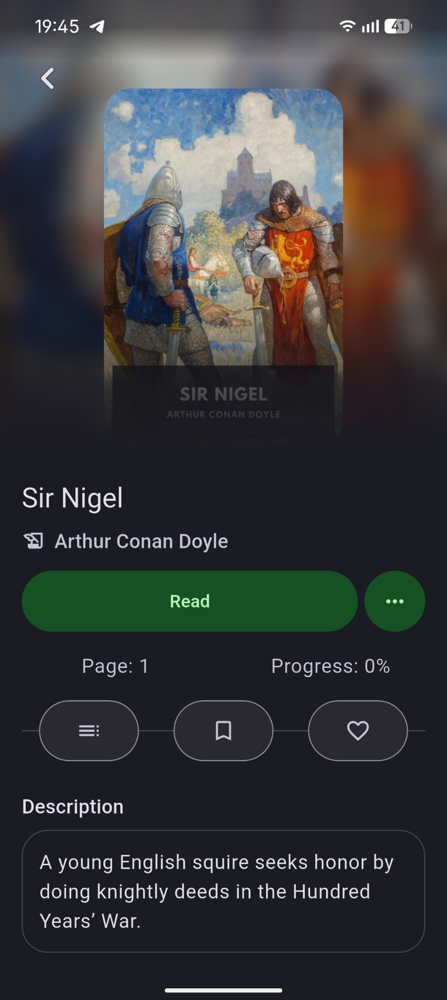
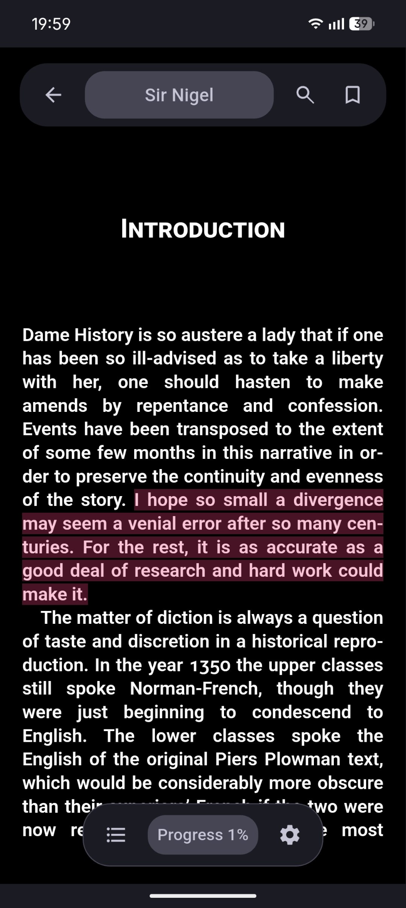
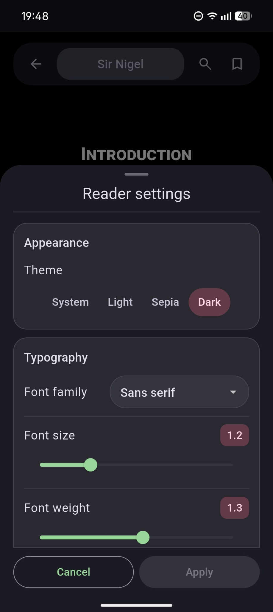
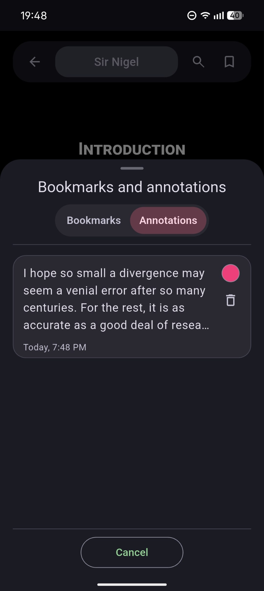
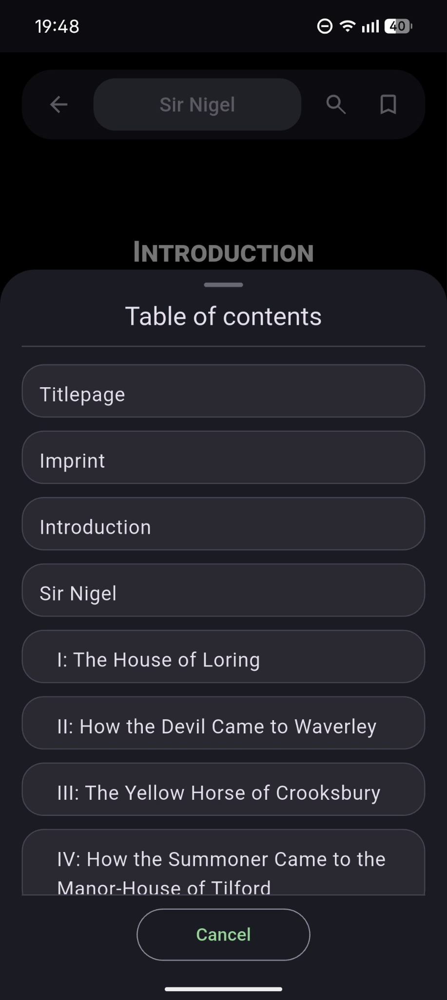

# BiblioLife

BiblioLife is an open-source Android library and reader built with Flutter and Readium. It supports EPUB (including fixed layout), PDF, FB2, TXT and CBZ.

## Download APK

Download the [BiblioLife v1.0.0 testing APK](https://github.com/byNFCK/bibliolife-open-source/releases/download/v1.0.0/BiblioLife-v1.0.0-profile-testing.apk) for Android 7.0 (API 24) or newer. This is a **profile testing build signed with Android Debug, not a production-signed release**.

1. Download `BiblioLife-v1.0.0-profile-testing.apk` and its [SHA-256 checksum](https://github.com/byNFCK/bibliolife-open-source/releases/download/v1.0.0/BiblioLife-v1.0.0-profile-testing.apk.sha256).
2. Open the APK. If Android prompts you, allow installs from the browser or file manager that opened it, then tap **Install**.

Package: `com.zeytr.bibliolife`; version: `1.0.0`; versionCode: `1`; variant: `profile`.

APK SHA-256: `4dc7b07d263deb07a42f8c2c038e4e987d4041da9754a32c857389eb90d643aa`.

Signer: `C=US, O=Android, CN=Android Debug`. Certificate SHA-256: `94348e9cbc0382365be3d11d400b4f92be5bbc7c59ea18efb7d09add9a956691`.

In-place updates require the same package ID and signing certificate and a compatible versionCode. A future production build signed with a different certificate cannot normally update this testing installation in-place. Export/back up your data before uninstalling; uninstalling removes app data.

The APK signature has been verified. No install or full functional acceptance report tied to this exact APK hash was found. See the [v1.0.0 release](https://github.com/byNFCK/bibliolife-open-source/releases/tag/v1.0.0) for the preserved source archive, SBOM, notices and original checksums. The existing SBOM describes the source release build; it is not a newly generated inventory of this APK. For local builds, see [Android setup](docs/development/setup.md).

## Screenshots

Tap any screenshot to open it at full size.

### Library and profile

|  Home |  Library grid |
| :---: | :---: |
|  Collections |  Profile |
|  Book details |  |

### Reader

|  Reader |  Reader settings |
| :---: | :---: |
|  Annotations |  Table of contents |

## What you can do

- Import local books, browse in grid or list view, and organize your library into collections.
- View and edit book details, pick a cover, and track your reading progress.
- Customize the EPUB reader and navigate using the table of contents, bookmarks and annotations.
- Browse online catalogs and download EPUBs. [Google Books search setup](docs/development/google_books_configuration.md) requires an API key.
- Choose light or dark appearance with dynamic color on supported devices.

CBR/RAR extraction is unavailable in v1.0.0. Existing CBR library entries and original files remain available for export. See the [fixed-layout EPUB font note](docs/release/android-fxl-font-patch.md) and [reader documentation](docs/index.md) for known limitations.

## Source and documentation

| Start here | Where to look |
| --- | --- |
| Build, test and contribute | [Development setup](docs/development/setup.md) · [Android build and signing](docs/development/build-and-release.md) · [Contributing](CONTRIBUTING.md) |
| Explore the code | [Flutter app](lib/) · [Android project](android/) · [Readium bridge](packages/bibliolife_readium/) · [Customized Readium Kotlin toolkit](third_party/readium-kotlin-toolkit/) |
| Explore the design and architecture | [Documentation index](docs/index.md) · [Architecture](docs/architecture/overview.md) · [Roadmap](docs/product/roadmap.md) |
| Review release provenance | [Artwork and assets](ASSETS.md) · [Asset provenance](docs/release/asset-provenance.md) · [Font provenance](docs/release/font-provenance.md) · [Release assets](https://github.com/byNFCK/bibliolife-open-source/releases/tag/v1.0.0) |

## License and third-party material

BiblioLife's original code and project-owned contributions are licensed under **GNU General Public License v3.0 or (at your option) any later version (GPL-3.0-or-later)**. The complete license text is in [`LICENSE`](LICENSE). The scope and exclusions are described in [`LICENSE_SCOPE.md`](LICENSE_SCOPE.md).

This license grant applies only to material for which the BiblioLife contributors have the rights to grant it. It does not relicense third-party or vendored components, fonts, icons, templates, test fixtures, or other assets that carry separate terms. Those materials retain their own licenses and notices; see [`THIRD_PARTY_NOTICES.md`](THIRD_PARTY_NOTICES.md).
