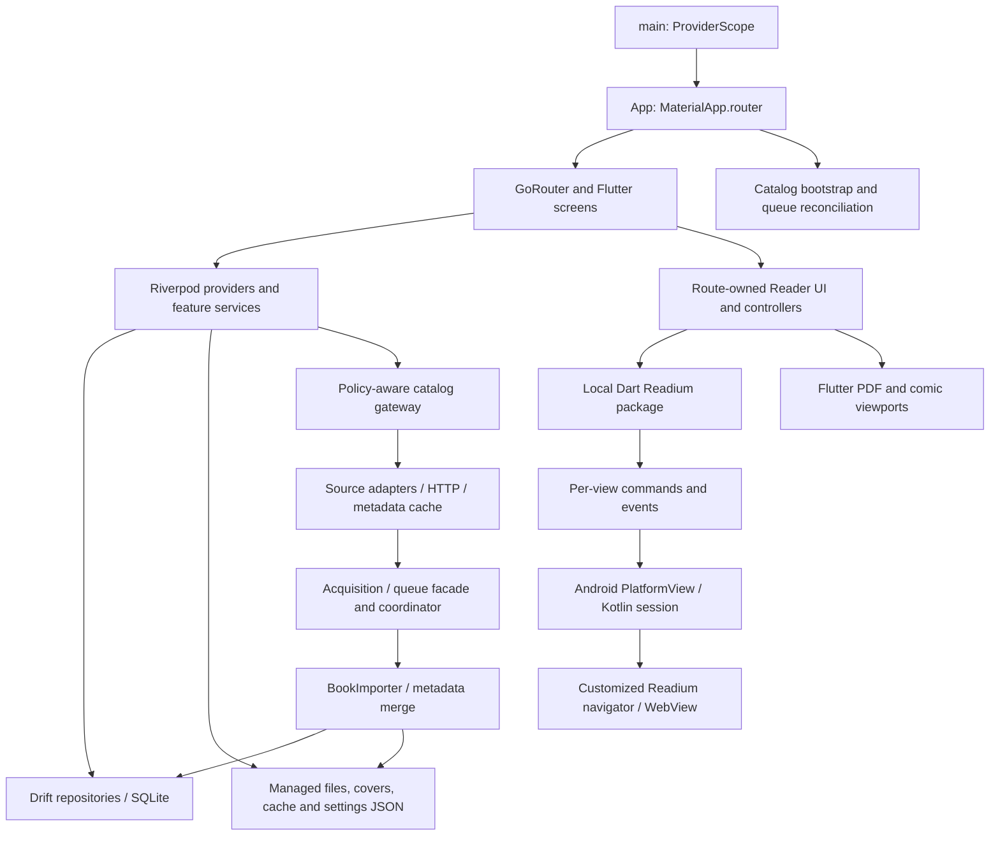

# Current application architecture

Source review: 2026-11-10. This reference describes the current working tree, including uncommitted Reader work. It records implemented ownership and boundaries; it does not certify release readiness or physical-device acceptance. Source files remain authoritative when this summary drifts.

## System view

The diagram shows principal dependencies and data paths, not a single synchronous execution sequence.

## Initialization and lifecycle

[main.dart](../../lib/main.dart) initializes Flutter bindings, emits startup performance-health information, configures the search image-cache policy, requests edge-to-edge system UI and starts one root ProviderScope containing App.

[App](../../lib/app/app.dart) initializes dynamic colors asynchronously and builds MaterialApp.router. It reads the application log service, watches built-in catalog-source bootstrap and download-queue startup reconciliation, and consumes router/theme providers. Those bootstrap operations are FutureProviders; startup does not synchronously await all persistence and network-feature setup before constructing the UI. Catalog bootstrap ensures built-in sources; queue reconciliation restores durable task state rather than treating interrupted work as successful.

Ownership is split by lifetime: root providers retain shared services, route widgets own Reader sessions/controllers, and the Android plugin owns engine/activity attachment. Provider disposal closes the database and selected HTTP/parser resources. Reader widget disposal and explicit session replacement release their adapters; the Android plugin handles activity configuration changes and engine detach. These are separate lifecycle boundaries, not a global background-execution guarantee.

## Dart structure and state ownership

The application follows feature-oriented organization:

| Area | Implemented responsibility |
| --- | --- |
| lib/app | Composition root, routing, theme and localization |
| lib/core | Database, performance instrumentation and shared infrastructure |
| lib/shared | Shared models, widgets and application logging |
| lib/features | Feature presentation, application wiring/services, domain contracts and data implementations |
| packages/bibliolife_readium | Local Dart API, Android plugin and Reader transport/session boundary |
| third_party/readium-kotlin-toolkit | Customized native renderer toolkit included by Android Gradle |

Feature folders are organizational boundaries within one Dart application, not separately isolated packages. Application providers import concrete data implementations to bind domain interfaces; screens and cross-feature services also share providers and models. Do not infer strict dependency inversion or complete independence from the directory names.

Riverpod supplies dependency wiring and observable state:

- Providers bind repositories/services, for example [appDatabaseProvider](../../lib/core/database/database_provider.dart) and the [catalog gateway providers](../../lib/features/catalog_sources/application/remote_catalog_gateway_provider.dart).
- StreamProviders expose repository observations, including catalog sources and persisted download tasks.
- FutureProviders perform bootstrap/reconciliation.
- Notifier/AsyncNotifier state owns mutable UI/application state; [BookImportNotifier](../../lib/features/import/application/providers/book_import_provider.dart) translates an import operation into loading/result state.
- Reader controller lifetimes are explicitly owned by widgets rather than assumed to be application-global Riverpod singletons.

Persistence is a repository responsibility: provider state alone does not establish durability. ThemeModeNotifier, for example, starts with system mode and does not itself persist changes.

## Navigation

[app_router.dart](../../lib/app/router/app_router.dart) starts at Home. A StatefulShellRoute.indexedStack retains separate Home, Library and Profile branches. [AppShell](../../lib/app/router/app_shell.dart) places the custom floating navigation island over the active branch; selecting the current destination requests that branch's initial location.

Search, settings, logs, collections/editors, catalog browsing/search, publication details, downloads and Reader are additional routes. Local Book Details and remote Publication Details use NoTransitionPage. Reader uses a CustomTransitionPage and accepts a book ID plus an optional validated ReaderLaunchRequest. The route resolves a persisted local library book before choosing a reader presentation. Online screens therefore do not hand an unpersisted remote publication directly to the local Reader.

For transition values and navigation styling, see [motion](../design/motion.md) and the [design system](../design/design-system.md).

## Feature boundaries

| Feature group | Main responsibility and boundary |
| --- | --- |
| home, library, collections | Discovery/presentation, local book views and collection membership/settings |
| import, metadata | Managed local ingestion, format metadata extraction, normalization and provenance-aware merging |
| catalog_sources, connectivity | Source configuration, remote discovery/search, acquisition planning, cache, download lifecycle and application Online/Offline authorization |
| book_details, bookmarks | Local book metadata/actions, stored locations and saved-item presentation |
| reader | Format selection, render adapters, Reader UI/settings/progress, annotations and session orchestration |
| search, settings, profile, app_logs | Their routed UI and associated state; a route's existence alone does not prove every possible product capability |

These features cooperate through shared book models, repositories and providers. The Online-to-import boundary reuses local ingestion instead of implementing a second local-library persistence path.

## Persistence

[AppDatabase](../../lib/core/database/app_database.dart) uses driftDatabase(name: 'bibliolife'), with an injectable QueryExecutor. The current schema version is **23**. The database provider owns closure. Tables and DAOs are declared in that source; generated mappings live in app_database.g.dart.

Persisted entities include books and metadata, reading progress, EPUB settings, collections/membership, bookmarks, annotations, connectivity mode, catalog sources, remote download tasks/cache budget, Home configuration, Library section and book-display settings. onCreate creates tables and initial cache-budget data; onUpgrade applies version-guarded changes. Version 20 adds collection description/custom-cover fields, version 21 adds book-display settings with an existence check, and subsequent migrations advance the current schema to version 23. beforeOpen enables SQLite foreign keys.

Persistence spans more than SQLite:

- [BookImporter](../../lib/features/import/data/services/book_importer.dart) copies originals into the application documents books directory using generated IDs and a partial-file rename.
- Covers and remote cache are managed through their storage services; database rows reference associated files.
- [FileReaderSettingsRepository](../../lib/features/reader/data/repositories/file_reader_settings_repository.dart), wired to the application-support directory, stores global renderer defaults as versioned JSON with serialized writes and interrupted-replacement recovery. This coexists with Drift EPUB settings.
- Download working files use a temporary-directory provider; durable task records do not guarantee a temporary file survives external removal.

File copying and SQL insertion are separate operations with compensating cleanup on import insertion failure; they are not one filesystem/SQLite transaction. Schema version is an implementation fact, not evidence that every historical migration has been exercised on a device.

## Local import and metadata

[Import provider wiring](../../lib/features/import/application/providers/import_repository_provider.dart) binds the file picker, local import repository, library/metadata repositories, cover storage, remote cache and MethodChannel TOC extractor.

The ingestion sequence is: select or supply a local file → determine format → check original-path duplication → copy through a .part file into managed storage → extract/validate metadata and EPUB TOC where supported → merge trusted remote metadata when supplied → normalize description and assess title → insert the LibraryBook through the library repository. Failure paths return explicit import results and remove controlled files where implemented. The original-path check is not a claim of universal content-hash deduplication.

[LocalBookMetadataRepository](../../lib/features/metadata/data/repositories/local_book_metadata_repository.dart) dispatches EPUB, FB2, CBZ and PDF parsers; TXT/CBR metadata extraction is not supplied by that dispatcher. [BookMetadataMerger](../../lib/features/metadata/data/services/book_metadata_merger.dart) uses field-specific rules: parsed title/authors take priority when present, trusted remote description takes priority, subjects are combined, and ISBN/date have dedicated selectors. It records origins; neither a blanket EPUB-first policy nor unrestricted remote overwrite describes the implementation.

## Online discovery, acquisition and downloads

The current [SourceAwareRemoteCatalogTransport](../../lib/features/catalog_sources/data/source_aware_remote_catalog_transport.dart) selects OPDS, Open Library, Google Books, Internet Archive discovery and Gutenberg adapters, with source-specific fallbacks. [Home online sections](../../lib/features/home/application/providers/online_home_sections_provider.dart) also exist. Discovery/search support does not imply every returned publication is downloadable.

The provider stack composes an IO HTTP client, request coordinator, memory/disk cache, retry policy and parser dispatcher/executor. The policy-aware gateway applies [NetworkAccessPolicy](../../lib/features/connectivity/application/network_access_policy.dart), which authorizes operations from application connectivity state; this is not a guarantee of actual Internet reachability.

Acquisition results feed [queue providers](../../lib/features/catalog_sources/application/remote_download_queue_provider.dart): the facade is the screen-facing enqueue/cancel/retry/import boundary; the coordinator owns sequential download execution; a Drift repository stores task state. The foreground downloader uses the network policy and controlled temporary files. Completed downloads pass through the temporary EPUB importer and the same BookImporter before local Book Details/Reader.

See the [Online technical baseline](online_technical_baseline.md) for the queue's detailed identity, retry/recovery and metadata-snapshot contract. It distinguishes its original OPDS 1 scope from current source-aware/Home discovery and identifies schema 13 as the introduction of the metadata snapshot, not the current application schema (21). [Google Books configuration](../development/google_books_configuration.md) documents the required API key and missing-key behavior.

## Reader and the Flutter–Kotlin boundary

[reader_kind.dart](../../lib/features/reader/domain/models/reader_kind.dart) maps EPUB to Readium, TXT/FB2 to generated reflowable publications, PDF to the Flutter PDF viewport and CBZ/CBR to comic presentation.

[ReaderRouteScreen](../../lib/features/reader/presentation/screens/reader_route_screen.dart) owns route/open-attempt state. [LocalReaderBody](../../lib/features/reader/presentation/screens/local_reader_body.dart) creates ReaderUiController/settings adapters and format-specific viewports. For EPUB it owns ReadiumEpubReaderController and annotation coordination, and can replace a session when the reading mode is committed. TXT/FB2 use [ReflowableReadiumPublicationService](../../lib/features/reader/application/services/reflowable_readium_publication_service.dart) to create/cache a generated EPUB. PDF uses pdfx; comics use image/archive services, including an Android channel for CBR extraction.

The application adapter coordinates library progress/settings repositories and Flutter chrome. The local package's [ReadiumBridgeClient](../../packages/bibliolife_readium/lib/src/bridge/readium_bridge_client.dart) transports typed commands/events for navigation, preferences, search, decorations, selection and progress interaction. [Bridge constants](../../packages/bibliolife_readium/lib/src/bridge/readium_bridge_constants.dart) define protocol version 1 and per-view command/event naming; MethodChannel commands and EventChannel events are not a shared database API.

[ReadiumEpubViewport](../../packages/bibliolife_readium/lib/src/bridge/readium_epub_viewport.dart) hosts an Android PlatformView, resolving supported HCPP composition with a legacy hybrid-composition fallback. Native [ReadiumPlatformViewBridge](../../packages/bibliolife_readium/android/src/main/kotlin/app/bibliolife/reader/readium/ReadiumPlatformViewBridge.kt) owns per-view transport and maps native session observations/results. [ReadiumReaderSession](../../packages/bibliolife_readium/android/src/main/kotlin/app/bibliolife/reader/readium/ReadiumReaderSession.kt) and associated platform-view/session classes own native reading operations and rendering state; the customized toolkit supplies navigator/WebView behavior.

Reader progress distinguishes displayed interaction state from persistable positions. The application adapter contains delayed persistence and cancellation/disposal handling; native command ownership/leases and Flutter scrub coordination fence asynchronous navigation work. These mechanisms are present in working source, but their existence is not proof of completed physical acceptance.

## Logging and diagnostics

[AppLogService](../../lib/shared/application/logging/app_log_provider.dart) is a Riverpod in-memory log capped at 1,000 entries, with UTC timestamps, formatted text and deferred append support during widget lifecycle operations. App initializes it; app_logs presents the log UI. It is not a durable disk-log database.

Performance utilities under lib/core/performance, EPUB metadata diagnostics, [ReaderOpenAttempt](../../lib/features/reader/application/services/reader_open_attempt.dart) and native diagnostics have separate responsibilities and output paths. Some are compile-time gated; there is no single universal logging switch or automatic assumption that native logs populate AppLogService. Native transport/session diagnostics and Android Logcat remain distinct from Flutter's in-app history.

The [local log-session convention](../../logs/README.md) describes manually organized development captures; it does not configure runtime output. Follow [benchmark safety](../testing/library_transition_benchmark_safety.md) before separate physical diagnostics.

## Platform dependencies and limitations

[pubspec.yaml](../../pubspec.yaml) declares Flutter/Dart, Riverpod, GoRouter, Drift, file/archive/XML tooling, dynamic_color, pdfx and the local Readium package. The [local plugin manifest](../../packages/bibliolife_readium/pubspec.yaml) registers an Android implementation only. Existing iOS/web/desktop scaffold directories do not establish Reader parity.

[Android Gradle settings](../../android/settings.gradle.kts) include the customized Readium checkout as a composite build, substitute toolkit modules and propagate local Android SDK configuration. Replacing it with stock upstream changes behavior. [App Gradle configuration](../../android/app/build.gradle.kts) targets Java/Kotlin 17, includes Junrar for CBR and uses a debug fallback for the toolkit in profile mode. Release signing is intentionally unset unless a private key is configured through android/key.properties; unsigned release builds are not production-ready.

## Architectural gaps and incomplete work

- Reader reflow, progress navigation and asynchronous lifecycle work remain represented by uncommitted changes and [active acceptance records](../index.md#active-reader-investigations-and-acceptance). Automated/source evidence and physical acceptance are separate.
- Annotation overlap/union merging remains constrained by selection-location capabilities; see [annotation limitations](reader_annotation_limitations.md).
- The detailed Online baseline intentionally focuses on acquisition/download/import. Source-specific discovery, canonical matching and live provider behavior still require their own validation rather than being inferred from queue guarantees.
- SQLite, managed files, caches and JSON settings have different recovery/lifetime contracts. This reference does not establish a unified backup/restore or crash-consistency guarantee.
- Cross-platform capability parity, comprehensive lifecycle acceptance and release signing are not established. Background downloads, authentication/DRM or other future capabilities must not be inferred from a transport interface or roadmap.
- Presentation, service composition and persistence have explicit owners, but feature boundaries are not mechanically isolated packages. Central controllers such as the Reader adapter coordinate multiple concerns.

No builds, tests or device checks were performed to prepare this document. Future plans are not reported as implemented behavior.
